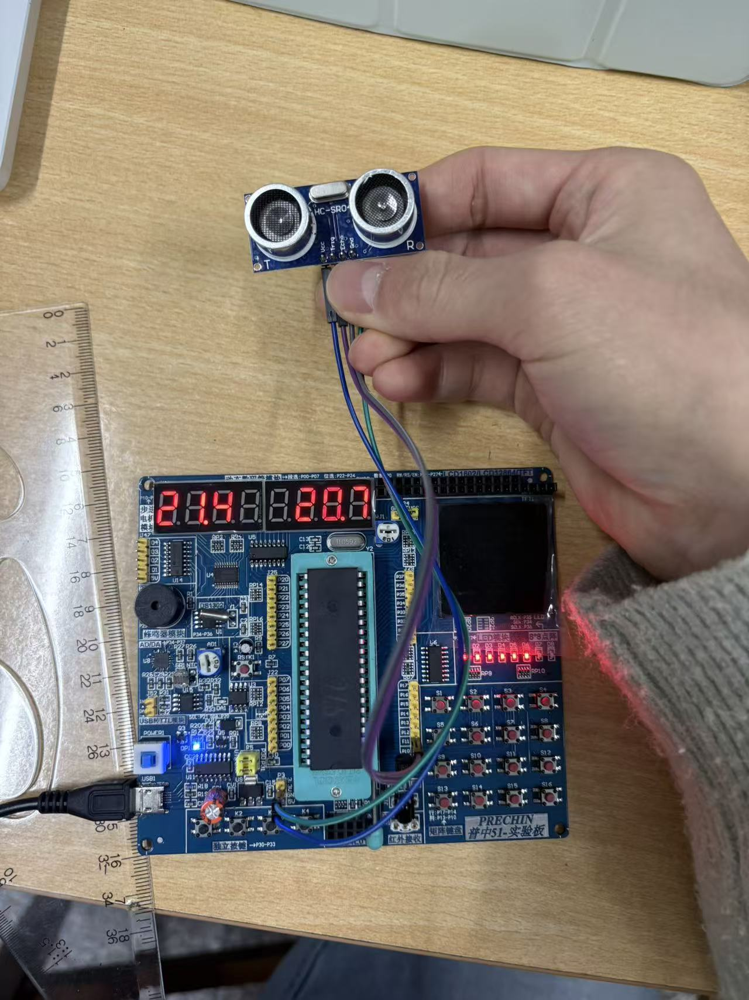

# 实验三实验记录与原理

测距流程：拉低并确认 Echo 空闲 → Trig 高电平至少 10μs → 等待 Echo 上升沿（超时退出）→ 记录定时器1起点 → 等待下降沿（超时退出）→ 读取时间差 → 按声速计算距离 → 更新显示与报警。

TMOD=0x11：T1、T0 均 GATE=0、C/T=0、M1:M0=01，即软件启动、内部机器周期计数、16位方式1。定时器计数频率为 11.0592MHz/12=921600Hz，一个计数约1.085μs。
T0 初值 FC66H=65536−922，名义中断间隔约1ms，逐位扫描八位，整屏约125Hz，实际包含中断重装延迟。T1 从0自由运行，无中断，以16位差值测量 Echo；30ms 超时小于约71.1ms溢出周期，支持一次自然回绕。与指导书启停T1的方法等价，但可同时为1-Wire提供时序基准。

基础版 d(cm)=N×34000/(2×921600)。改进版 v(m/s)=331.4+0.6T；程序用整数表示温度十分位，声速厘米每秒为33140+6×T10，距离十分之一厘米为 round(N×v/184320)，避免浮点运算。DS18B20 启动转换后等待至少约1秒再读，读取全部9字节并校验CRC，不把上电暂存值直接作为首次转换结果。

按老师要求修改：超声波改接 P1.0/P1.1；左四位显示距离；右四位显示温度，取消切换显示。板载DS18B20采用厂商P3.7接口，另提供指导书P2.6接线版本。

## 实测数据（2026-11-16）

按用户转述，老师确认记录以下四组即可，不再要求第五组。当前烧录的是温度补偿改进版。原始左侧读数依次为5.4L、10.4L、20.2L、40.4L；L是距离显示锁定标志，不是单位或数字。温度仍实时更新，表中温度为用户记录时的显示值，不一定是锁定距离瞬间的温度。

|标尺距离/cm|补偿版显示/cm|温度/℃|绝对误差/cm|相对误差|
|---|---|---|---|---|
|5|5.4|19.1|0.4|8.0%|
|10|10.4|19.4|0.4|4.0%|
|20|20.2|19.5|0.2|1.0%|
|40|40.4|20.0|0.4|1.0%|

四组读数均偏大，偏差分别为+0.4、+0.4、+0.2、+0.4cm；平均绝对误差0.35cm，最大绝对误差0.4cm。近距离相对误差较大。偏差可能与测距基准面、反射面位置与角度、边沿检测延迟等有关，仅凭四组数据不能确定具体原因。

未采集基础版对照数据，因此不填写补偿前后误差改善比例；不要求用户继续补测，报告如实注明本次完成温度补偿功能及四组距离测量。

绝对误差=|显示距离−标尺距离|；相对误差=绝对误差/标尺距离×100%；误差改善比例=(基础绝对误差−补偿绝对误差)/基础绝对误差×100%，基础误差为0时不定义该比例。误差来源包括反射面角度、探头基准面定位、声速与环境、回波边沿轮询/中断延迟、晶振与显示取整。温度补偿不保证每次测量误差都减小，以实测为准。

2026-11-16硬件反馈：用户确认测距、蜂鸣正常；修复1-Wire时序并重新烧录后，用户确认温度已显示。本次四组实测距离已记录；未测补偿前后对照误差。读数L支持当时处于锁定状态，但解锁恢复全过程尚无单独验收反馈。

## 实物照片

照片可见HC-SR04与开发板连接，数码管左侧约21.4cm、右侧约20.7℃。这是另外一次运行画面，不对应上表任意一组标尺测量，不能依据照片中的尺子推算该次真实距离。照片不能证明蜂鸣声音，蜂鸣正常依据用户此前反馈。
